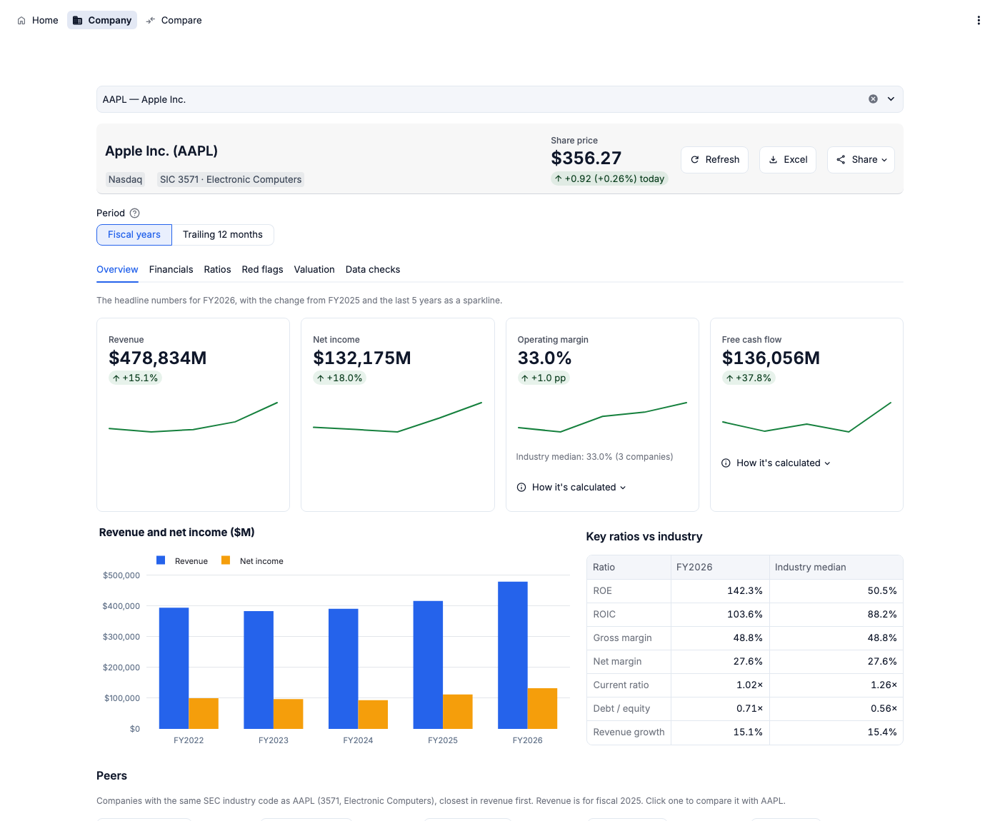
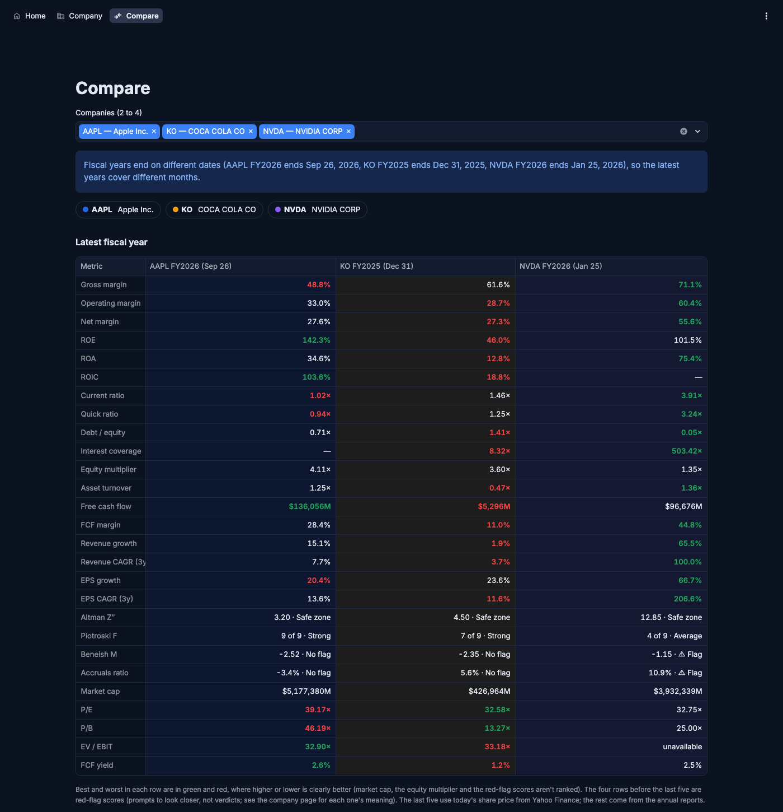
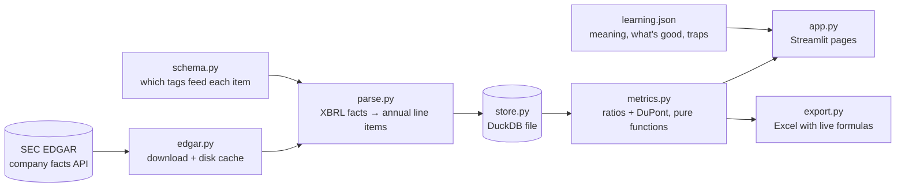

# Finance Analyzer

A free, open-source app that helps students analyse and compare US public companies, and teaches what
each number means. Type a ticker and it pulls the company's annual reports from SEC EDGAR, maps them onto
one standard set of line items, and shows 15 ratios plus the DuPont breakdown, each with its formula
filled in with the company's real numbers, what it means, what a good value looks like and common traps.

Built for finance and business students doing case studies, stock pitches and theses.

## Screenshots

> _Placeholders: add images to `docs/screenshots/` and they'll show here._

| Company page | Compare page |
|---|---|
|  |  |

## Features

- **Company page:** five years of line items (derived values marked and explained), metric cards with
  the latest value, the change on last year and a "Formula and meaning" panel, trend charts (revenue,
  net income, margins, ROE) and the DuPont breakdown.
- **Compare page:** 2–4 companies side by side, an overlaid chart for any metric, and a note when their
  fiscal years end on different dates (Apple in September, NVIDIA in January).
- **Excel export:** a workbook whose metric cells are live formulas over the line-item sheet, so you
  can trace and change every number.
- **Honest gaps:** when a ratio can't be calculated, the app says why (e.g. *interest_expense not
  reported for FY2026*) instead of showing a wrong number. Banks and insurers get a warning banner.

Metrics: gross, operating and net margin · ROE, ROA, ROIC · current and quick ratio · debt/equity,
interest coverage, equity multiplier · asset turnover · free cash flow and FCF margin · revenue and EPS
growth (1-year and 3-year CAGR) · DuPont.

## Setup

You need [uv](https://docs.astral.sh/uv/) (it installs Python 3.12 and the packages for you).

```bash
git clone https://github.com/VedantParashar/finance-analyzer.git
cd finance-analyzer
uv sync
cp .env.example .env   # then edit it: the SEC asks every client to say who it is
```

`.env` holds one setting, `SEC_USER_AGENT`, a name and contact email such as
`Finance Analyzer you@example.com`. The SEC refuses requests without it. `.env` is git-ignored.

## Run

```bash
uv run --env-file .env finance-analyzer
```

Then open http://localhost:8501. The first view of a company downloads its filings (a few seconds);
after that it's read from the local database.

### Or with Docker (one command)

With [Docker](https://docs.docker.com/get-docker/) installed and `.env` filled in:

```bash
docker compose up --build
```

Then open http://localhost:8501. The database and downloads are kept in `./data`, shared with the
non-Docker setup. Stop with Ctrl+C.

### Tests

Run the tests (they use fake data, no network needed):

```bash
uv run pytest
```

They also run on GitHub Actions for every push and pull request.

## How it works



- **Data adapter** (`edgar.py`, `parse.py`): downloads a company's XBRL "company facts", keeps full-year
  10-K and 10-K/A values, de-duplicates them by period end (latest filing wins), adjusts per-share
  values for stock splits and builds items some companies only report in parts (e.g. short-term debt =
  commercial paper + current maturities).
- **Standard schema** (`schema.py`, `store.py`): 23 line items with a priority list of XBRL tags each,
  stored in a local DuckDB file with the filing they came from and how any derived value was calculated.
- **Metrics engine** (`metrics.py`): pure functions that return the value, every input used, and the
  reason when a value can't be calculated. Tested against hand-calculated values for Apple and Coca-Cola.
- **UI** (`app.py`, `display.py`): only displays what the engine computes.

## Data sources

- [SEC EDGAR XBRL company facts](https://www.sec.gov/search-filings/edgar-application-programming-interfaces)
  for financial statements (free, no API key).
- SEC submissions API (same documentation) for the company name and industry code (SIC),
  used to spot banks and insurers.

Downloads are cached in `data/cache/` and parsed rows stored in `data/finance.duckdb` (both git-ignored).

## Limitations

- **US companies only.** Banks and insurers are out of scope: they get a warning and many ratios show as
  unavailable.
- **Annual data only** (10-K and 10-K/A), no quarters.
- **No share price yet**, so no P/E or market cap (planned with yfinance).
- **Tag choices are tested on five companies** (AAPL, KO, TSLA, NVDA, JPM), so other companies may report
  an item under a tag we don't read yet. Known data issues:
  - [#1](https://github.com/VedantParashar/finance-analyzer/issues/1) absent items are only treated as zero
    when the company never reports them
  - [#2](https://github.com/VedantParashar/finance-analyzer/issues/2) the temporary-equity rule is based on
    Tesla only
  - [#4](https://github.com/VedantParashar/finance-analyzer/issues/4) the download cache never refreshes,
    so new filings don't appear until `data/cache/` is cleared
  - [#5](https://github.com/VedantParashar/finance-analyzer/issues/5) `LongTermDebt` means total debt at
    some companies and non-current debt at others
  - [#6](https://github.com/VedantParashar/finance-analyzer/issues/6) NVIDIA's FY2026 short-term
    investments use a company-specific tag, so its ROIC that year is unavailable
  - [#3](https://github.com/VedantParashar/finance-analyzer/issues/3) (closed) Tesla FY2014–15 don't
    balance; documented and accepted
- Ratio definitions follow one common convention (e.g. averaged balances for ROE). Other sources may
  differ slightly.

## License

No license chosen yet.
