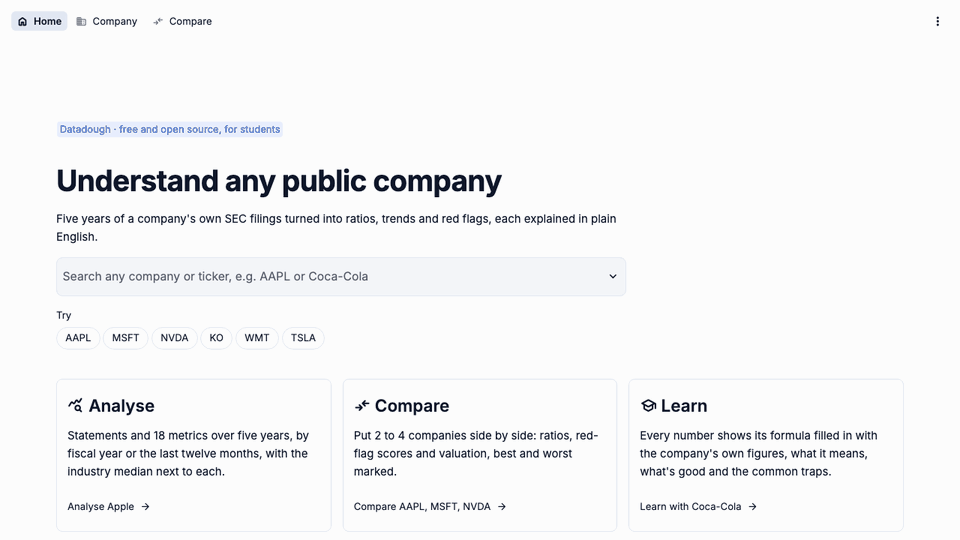

# Datadough

**Company financials you can trace back to the filing: every number links to the SEC document it came from.**

[](https://datadough.streamlit.app)

[](https://github.com/VedantParashar/finance-analyzer/actions/workflows/ci.yml)
[](https://github.com/VedantParashar/finance-analyzer/releases)
[](LICENSE)
[](https://www.python.org/)

A free, open-source research app for students doing case studies, stock pitches and theses. Type a
ticker: it reads the company's annual reports from SEC EDGAR, puts them on one standard set of line
items, and shows five years of statements, 19 ratios, red-flag scores and valuation, each explained in
plain English with the company's own numbers.



## What makes it different

- **Trace any number.** Every line item and every input to a ratio links to the exact SEC filing it was
  read from, with the form type and filing date. Calculated values say how they were calculated.
- **Rules you can read.** [METHODOLOGY.md](docs/METHODOLOGY.md) explains how each number is chosen
  (tag priority, restatements, stock splits, derived items, the balance check) with real examples:
  Apple's restated FY2008, NVIDIA's splits, TSMC's bonds.
- **Accuracy is measured, not assumed.** [ACCURACY.md](docs/ACCURACY.md) checks 10 headline figures
  for 10 companies against the filings themselves: 93 of 95 match, and both differences are explained.
- **Honest gaps.** A ratio that can't be calculated says why ("interest expense not reported for
  FY2026") instead of showing a wrong number, and a missing value is never treated as zero.
  [COVERAGE.md](docs/COVERAGE.md) lists what's found for 30 very different companies.

## Features

- **Company page** in tabs: Overview (headline cards with sparklines, revenue and profit, key ratios
  against the industry median), Financials (line items with their source), Ratios, Red flags,
  Valuation and Data checks. Switch between fiscal years and the trailing twelve months.
- **19 ratios:** margins, ROE, ROA, ROIC, liquidity, leverage, efficiency, free cash flow, growth and
  the DuPont breakdown. Each card's "How it's calculated" shows the formula with the real numbers, what
  it means, what's good, the common traps, and a link to report a number that looks wrong.
- **Red-flag scores** every year: Altman Z″, Piotroski F, Beneish M and the accruals ratio.
- **Valuation at today's price:** market cap, P/E, P/B, EV/EBIT and FCF yield.
- **Compare 2 to 4 companies**, with each company's colour kept across the table and the chart and the
  best and worst value in each row marked.
- **Excel export** whose metric cells are live formulas over the line items.
- **Shareable links** (`?ticker=AAPL`, `?compare=AAPL,KO`), peer suggestions, light and dark themes.

## Supported companies

| | |
|---|---|
| ✅ **Works** | US companies that file annual reports (10-K) with the SEC, from about 2009 on. |
| ✅ **Works, in the company's own currency** | Foreign companies listed in the US that file a 20-F or 40-F, under US GAAP or IFRS (TSMC, ASML, SAP, Novo Nordisk, Toyota). Amounts stay in the reporting currency; only market cap is converted, for the valuation ratios. |
| ⚠️ **Works with a warning** | Banks, brokers and insurers (JPM, GS, BRK-B): many ratios don't apply to them. REITs get FFO (funds from operations) instead of the ratios that don't fit. |
| ❌ **Doesn't work** | ETFs and funds (no financial statements), companies not yet past their first annual report, and companies not listed in the US. The app says which it is. |

## Data sources

Financial statements from [SEC EDGAR](https://www.sec.gov/search-filings/edgar-application-programming-interfaces)
(XBRL company facts and submissions, free, no API key); share prices and exchange rates from Yahoo
Finance through [yfinance](https://github.com/ranaroussi/yfinance). Not investment advice.

## Run it on your computer

The SEC asks every client to say who it is: copy `.env.example` to `.env` and put your name and email
in `SEC_USER_AGENT`. With [uv](https://docs.astral.sh/uv/):

```bash
git clone https://github.com/VedantParashar/finance-analyzer.git
cd finance-analyzer
cp .env.example .env   # then edit it
uv run --env-file .env finance-analyzer
```

Then open http://localhost:8501. With Docker instead: `docker compose up --build`. Tests:
`uv run pytest`. To host your own copy for free, see [DEPLOY.md](DEPLOY.md).

## Limitations

- **SEC filers only**, and only what they tag in their XBRL data. A company that uses an unusual tag
  for a common line shows "—" with the reason.
- **IFRS filers have more gaps** (Toyota has no cost of revenue or capital expenditure in the data),
  and energy companies, utilities and REITs lay out their statements differently
  ([#27](https://github.com/VedantParashar/finance-analyzer/issues/27),
  [#31](https://github.com/VedantParashar/finance-analyzer/issues/31),
  [#33](https://github.com/VedantParashar/finance-analyzer/issues/33)). ExxonMobil can't be loaded
  ([#32](https://github.com/VedantParashar/finance-analyzer/issues/32)).
- **Valuation mixes dates:** today's share price against the last full fiscal year, so P/E differs
  from sites that use the last twelve months. Share prices come from Yahoo Finance, which is
  unofficial; if it fails, the valuation cards read "unavailable" and the rest still works.
- **Industry medians** use only the companies loaded into the app, so the sample is small.
- Known data issues are in the [issue list](https://github.com/VedantParashar/finance-analyzer/issues?q=is%3Aopen+label%3Adata-quality).

## How this was built

Datadough was built with [Claude Code](https://claude.com/claude-code), Anthropic's AI coding tool,
which wrote most of the code, tests and documents. I'm the owner and a beginner programmer: I wrote the
spec and each session's task list, made the design decisions, and reviewed and merged every pull
request. Each decision Claude made on its own, with its reasons and the alternatives it rejected, is
recorded in the [decision log](docs/decision-log.md); the terms I learned along the way are in
[LEARNING.md](LEARNING.md).

## Contributing and license

Wrong number? Use "Report a wrong number" in the app, or
[open an issue](https://github.com/VedantParashar/finance-analyzer/issues/new/choose) with the ticker.
See [CONTRIBUTING.md](CONTRIBUTING.md) for setup and the pull request workflow, and
[CHANGELOG.md](CHANGELOG.md) for what each version added. [MIT](LICENSE) licensed.
