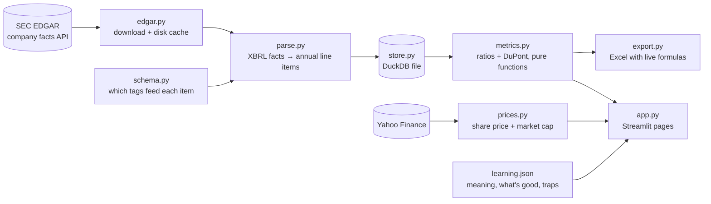

# Finance Analyzer

[](https://datadough.streamlit.app)

**Live app: https://datadough.streamlit.app** (free, nothing to install)

A free, open-source app that helps students analyse and compare public companies that file with the US
SEC, and teaches what
each number means. Type a ticker and it pulls the company's annual reports from SEC EDGAR, maps them onto
one standard set of line items, and shows 15 ratios plus the DuPont breakdown, each with its formula
filled in with the company's real numbers, what it means, what a good value looks like and common traps.

Built for finance and business students doing case studies, stock pitches and theses.

## Screenshots

| Company page | Compare page |
|---|---|
|  |  |

## Use it online

1. Open **https://datadough.streamlit.app**.
2. On the **Company** page, type a ticker or a company name (`AAPL` or `Apple`) and pick it from the
   suggestions, or click one of the popular examples. You get five years of line items, the ratios with
   their formulas, valuation at today's price, trend charts and data checks.
3. On the **Compare** page, pick 2 to 4 companies the same way.
4. **Download Excel with live formulas** gives you a workbook you can change and trace.

Good to know: the first view of a company takes a few seconds while its filings download. The hosted
app sleeps when nobody has used it for a while; if you see a "wake up" screen, click the button and
wait a minute. Share prices come from Yahoo Finance, which sometimes blocks hosted apps; the five
valuation metrics then read "unavailable" and everything else still works.

## Run it on your computer

Both ways need one setting: the SEC asks every client to say who it is. Copy `.env.example` to `.env`
and put your own name and email in `SEC_USER_AGENT` (e.g. `Finance Analyzer you@example.com`).
`.env` is git-ignored.

### With uv

[uv](https://docs.astral.sh/uv/) installs Python 3.12 and the packages for you.

```bash
git clone https://github.com/VedantParashar/finance-analyzer.git
cd finance-analyzer
uv sync
cp .env.example .env   # then edit it
uv run --env-file .env finance-analyzer
```

Then open http://localhost:8501.

### With Docker

With [Docker](https://docs.docker.com/get-docker/) installed and `.env` filled in:

```bash
git clone https://github.com/VedantParashar/finance-analyzer.git
cd finance-analyzer
cp .env.example .env   # then edit it
docker compose up --build
```

Then open http://localhost:8501. Stop with Ctrl+C.

Either way, downloads and the database are kept in `./data`. Downloads refresh by themselves once
they're 7 days old, and the **Refresh data** button on the company page fetches a new filing straight
away. To host your own copy for free, see [DEPLOY.md](DEPLOY.md).

## Supported companies

| | |
|---|---|
| ✅ **Works** | US companies that file annual reports (10-K) with the SEC, from about 2009 on. Checked in detail on Apple, Coca-Cola, Tesla and NVIDIA. |
| ✅ **Works, in the company's own currency** | Foreign companies listed in the US that file a 20-F or 40-F, under US GAAP or IFRS (e.g. TSMC, ASML, SAP, Toyota). Amounts are shown in the reporting currency (TWD, EUR, JPY) and not converted. For the valuation ratios, market cap is converted into that currency at today's exchange rate. Some items have gaps: see [Limitations](#limitations). |
| ⚠️ **Works with a warning** | Banks, brokers and insurers (e.g. JPM, GS, BRK-B). They load, but ratios like gross margin and current ratio don't apply to them, so many show as unavailable. |
| ⚠️ **May have gaps** | Any company that reports an item under a tag the app doesn't read yet. The value shows as "—" with the reason; the **Data checks** section shows whether the balance sheet adds up. |
| ❌ **Doesn't work yet** | ETFs and funds (e.g. SPY), which have no financial statements. Companies that have listed recently and not yet filed an annual report. Companies not listed in the US. In each case the app says which it is. Quarterly figures. |

[docs/COVERAGE.md](docs/COVERAGE.md) lists what is and isn't found for 30 very different companies
(mega caps, small caps, retail, energy, pharma, utilities, REITs, foreign filers, recent IPOs).

## Report a problem

Wrong number, missing value or an error? Please
[open an issue](https://github.com/VedantParashar/finance-analyzer/issues/new/choose) and include the
ticker and a screenshot. Known problems are listed under [Limitations](#limitations) and in the
[issue list](https://github.com/VedantParashar/finance-analyzer/issues).

## Features

- **Company page:** five years of line items (derived values marked and explained), metric cards with
  the latest value, the change on last year and a "Formula and meaning" panel, trend charts (revenue,
  net income, margins, ROE) and the DuPont breakdown.
- **Compare page:** 2–4 companies side by side, an overlaid chart for any metric, and a note when their
  fiscal years end on different dates (Apple in September, NVIDIA in January).
- **Excel export:** a workbook whose metric cells are live formulas over the line-item sheet, so you
  can trace and change every number.
- **Data checks:** for every stored year, whether assets = liabilities + equity (and by how much it's
  off if not), plus any gap in the run of fiscal years.
- **Honest gaps:** when a ratio can't be calculated, the app says why (e.g. *interest_expense not
  reported for FY2026*) instead of showing a wrong number. Banks and insurers get a warning banner.

Metrics: gross, operating and net margin · ROE, ROA, ROIC · current and quick ratio · debt/equity,
interest coverage, equity multiplier · asset turnover · free cash flow and FCF margin · revenue and EPS
growth (1-year and 3-year CAGR) · DuPont · four red-flag scores (Altman Z″, Piotroski F, Beneish M, accruals ratio) · and, at today's share price, market cap, P/E, P/B, EV/EBIT and
FCF yield.

## How it works



- **Data adapter** (`edgar.py`, `parse.py`): downloads a company's XBRL "company facts", keeps full-year
  10-K and 10-K/A values, de-duplicates them by period end (latest filing wins), adjusts per-share
  values for stock splits and builds items some companies only report in parts (e.g. short-term debt =
  commercial paper + current maturities).
- **Standard schema** (`schema.py`, `store.py`): 23 line items with a priority list of XBRL tags each,
  stored in a local DuckDB file with the filing they came from and how any derived value was calculated.
- **Metrics engine** (`metrics.py`): pure functions that return the value, every input used, and the
  reason when a value can't be calculated. Tested against hand-calculated values for Apple and Coca-Cola.
- **UI** (`app.py`, `display.py`): only displays what the engine computes.

## Data sources

- [SEC EDGAR XBRL company facts](https://www.sec.gov/search-filings/edgar-application-programming-interfaces)
  for financial statements (free, no API key).
- SEC submissions API (same documentation) for the company name and industry code (SIC),
  used to spot banks and insurers.

- [Yahoo Finance](https://finance.yahoo.com/) through the [yfinance](https://github.com/ranaroussi/yfinance)
  package for today's share price and market cap. It's unofficial, so it can stop working without notice.

Downloads are cached in `data/cache/` and parsed rows stored in `data/finance.duckdb` (both git-ignored).

## Limitations

- **Only companies that file with the US SEC.** Banks and insurers are out of scope: they get a warning
  and many ratios show as unavailable.
- **Annual data only** (10-K, 20-F, 40-F and amendments), no quarters.
- **Statements aren't converted.** Foreign filers are shown in their own currency. Comparing ratios across
  currencies is fine; comparing amounts isn't. Only market cap is converted, at today's exchange rate from
  Yahoo Finance, so that P/E, P/B, EV/EBIT and FCF yield work; if the rate can't be fetched they read
  "unavailable".
- **IFRS companies have more gaps** than US ones, because IFRS lets companies name their own lines:
  Toyota has no cost of revenue or capital expenditure, so no gross margin, free cash flow or FCF yield.
- **Valuation mixes dates:** today's share price against the last full fiscal year (not the last twelve
  months), so P/E here differs from finance websites. If Yahoo Finance doesn't answer, the five valuation
  metrics show "unavailable" and everything else still works.
- **Tag choices are tested on five companies** (AAPL, KO, TSLA, NVDA, JPM), so other companies may report
  an item under a tag we don't read yet. Known data issues:
  - [#1](https://github.com/VedantParashar/finance-analyzer/issues/1) absent items are only treated as zero
    when the company never reports them
  - [#2](https://github.com/VedantParashar/finance-analyzer/issues/2) the temporary-equity rule is based on
    Tesla only
  - [#5](https://github.com/VedantParashar/finance-analyzer/issues/5) `LongTermDebt` means total debt at
    some companies and non-current debt at others
  - [#6](https://github.com/VedantParashar/finance-analyzer/issues/6) NVIDIA's FY2026 short-term
    investments use a company-specific tag, so its ROIC that year is unavailable
  - [#3](https://github.com/VedantParashar/finance-analyzer/issues/3) (closed) Tesla FY2014–15 don't
    balance; documented and accepted
- **Some industries fit badly:** REITs, utilities and oil companies lay out their statements differently,
  so several ratios are unavailable for them
  ([#29](https://github.com/VedantParashar/finance-analyzer/issues/29),
  [#31](https://github.com/VedantParashar/finance-analyzer/issues/31),
  [#33](https://github.com/VedantParashar/finance-analyzer/issues/33)). ExxonMobil can't be loaded at all
  ([#32](https://github.com/VedantParashar/finance-analyzer/issues/32)).
- Ratio definitions follow one common convention (e.g. averaged balances for ROE). Other sources may
  differ slightly.

## Contributing

See [CONTRIBUTING.md](CONTRIBUTING.md) for setup, tests and the pull request workflow, and
[CHANGELOG.md](CHANGELOG.md) for what each version added.

## License

[MIT](LICENSE): free to use, change and share, as long as the copyright notice stays with it.
